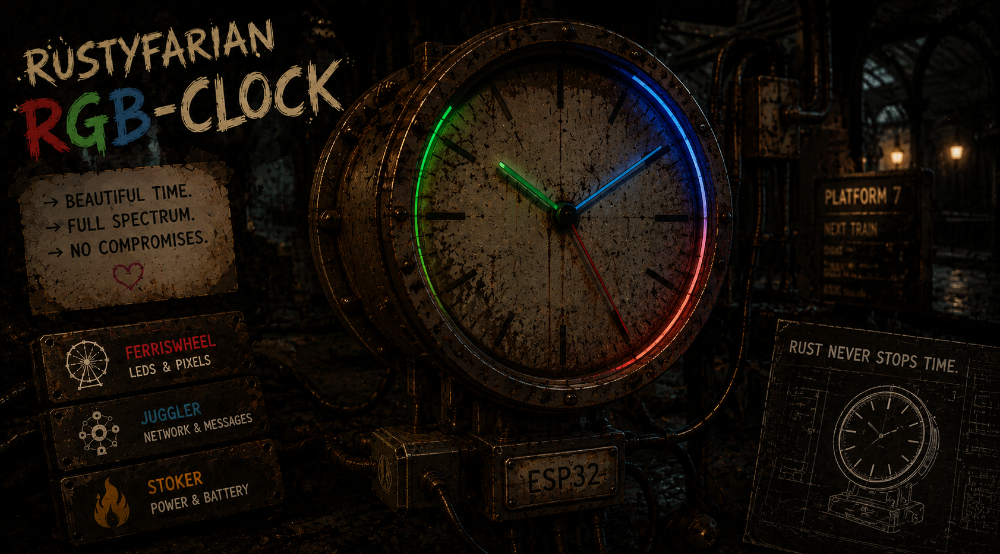
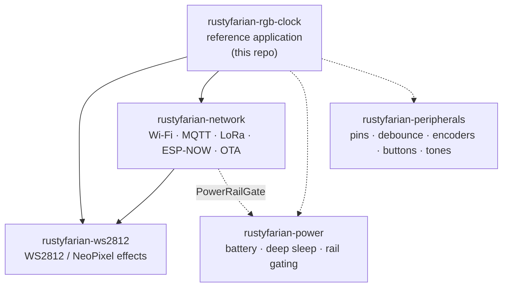

# Rustyfarian RGB Clock

<p align="center">
  
</p>

[](https://github.com/datenkollektiv/rustyfarian-rgb-clock/actions/workflows/rust.yml)
[](#license)
[](https://www.rust-lang.org)
[](https://github.com/datenkollektiv/rustyfarian-rgb-clock/actions/workflows/fmt.yml)
[](https://github.com/datenkollektiv/rustyfarian-rgb-clock/actions/workflows/clippy.yml)
[](https://github.com/datenkollektiv/rustyfarian-rgb-clock/actions/workflows/audit.yml)

An RGB LED clock for the ESP32-C6 and ESP32-C3 that shows the time on a ring of 12 WS2812 NeoPixel LEDs, with the time received via MQTT.

> **Note:** Large parts of this project (and its documentation) were developed with the assistance of AI tools.
> All generated code has been reviewed and curated by the maintainer.

## Vision

> Validate a replicable three-tier embedded testing pyramid (host tests, Wokwi simulation, hardware-in-the-loop) using a working RGB clock as the test fixture.
> That lets future rustyfarian projects adopt the approach with confidence.

**We are building this for:** ourselves — learning and preparation for future embedded Rust projects and for future rustyfarian projects that will inherit this testing approach.

**Long-term goals:**
- All three testing tiers running green in CI
- Documentation is good enough to replicate the testing pyramid in new projects
- Mature the shared rustyfarian crates through real usage and test coverage

**Out of scope:** new clock features (those belong in other projects), hardware compatibility beyond ESP32-C6, and building a general-purpose testing framework.

*Full vision, success signals, and open questions: [VISION.md](./VISION.md)*

## Rustyfarian Philosophy

This project embodies the principle of **extracting testable pure logic from hardware-specific code** — a pattern common in application development but rare in embedded Rust.

- `clock-pure` maps the time to LED indices and colours with no hardware dependencies, so `just test` covers it on the host.
- `clock-app` is the shared async clock loop (MQTT tick in, ring frame out) that both firmware tiers run unchanged.
- The ESP-IDF firmware and `rustyfarian-esp-hal-rgb-clock` only wire LEDs, Wi-Fi and MQTT to that logic.

## Rustyfarian Family

`rustyfarian-rgb-clock` is one repo in the **rustyfarian** family — composable embedded-Rust libraries for battery-powered ESP32 field deployments (e.g. remote beehive monitoring over LoRaWAN).



Solid edge: depends on it today.
Dotted edge: a natural fit, not adopted yet.

| Repo                                                                             | Role                                                    |
|:---------------------------------------------------------------------------------|:--------------------------------------------------------|
| [rustyfarian-ws2812](https://github.com/datenkollektiv/rustyfarian-ws2812)       | WS2812 / NeoPixel LED effects and drivers               |
| [rustyfarian-network](https://github.com/datenkollektiv/rustyfarian-network)     | Wi-Fi, MQTT, LoRa, ESP-NOW, OTA                         |
| [rustyfarian-peripherals](https://github.com/datenkollektiv/rustyfarian-peripherals) | Pins, debounce, encoders, buttons, tones            |
| [rustyfarian-power](https://github.com/datenkollektiv/rustyfarian-power)         | Battery monitoring, deep sleep, power rail gating       |
| **rustyfarian-rgb-clock** (this repo)                                            | Reference application tying the libraries together      |

## Hardware

| Signal                   | ESP32-C6 pin | ESP32-C3 pin |
|:-------------------------|:-------------|:-------------|
| WS2812 clock ring (DIN)  | **GPIO 18**  | **GPIO 4**   |
| Onboard RGB LED          | GPIO 8       | GPIO 8       |

The ring uses the rustyfarian standard WS2812 data pin per chip, the same wiring as the `rustyfarian-ws2812` examples.
Pin assignments live in `src/main.rs`.

## Quick Start

Build for ESP32-C6 (default)

```sh
just build
```

Build for ESP32-C3

```sh
just build idf_c3_rgb_clock
```

Flash and open monitor (ESP32-C6 default)

```sh
just run
just monitor
```

Flash or run for ESP32-C3

```sh
just flash idf_c3_rgb_clock
just run idf_c3_rgb_clock
```

Port auto-detection in `scripts/detect-port.sh` works on macOS and Linux.
On Windows, set `ESPFLASH_PORT` before flashing:

```sh
ESPFLASH_PORT=COM3 just flash
```

Run the host checks (format, partition table, host clippy, host tests), then the firmware check and clippy

```sh
just verify
just verify-fw
```

The partition checks run first because they are the cheapest and guard the most expensive mistake.
`just partition-check` validates `partitions.csv` against the rules ESP-IDF enforces only at flash time:

- 64 KiB alignment for app partitions
- exact `type/subtype` pairs
- `otadata` sized to two sectors
- no overlaps
- slots large enough for the image
- `nvs` still at its original offset so provisioned credentials survive

`just partition-check-tests` runs a 12-case regression suite over the fixtures in `scripts/partition-fixtures/`.
It asserts that each way a table can be wrong is still rejected with the right diagnostic.
`just partition-check` and `just partition-check-tests` both run in CI.

Wi-Fi and MQTT credentials are provisioned at runtime via a SoftAP captive portal — no credentials live in the firmware image.
A `.env` is optional: it only supplies **non-secret** defaults that pre-fill the portal form (see `.env.example`); passwords are never set there.
On first boot (or after `just erase-flash`) the clock ring pulses amber and the device hosts an open `Rustyfarian-XXXX` access point.
Connect to it, open the captive portal, and submit your Wi-Fi + MQTT details.
See [docs/features/archive/wifi-softap-provisioning-v1.md](docs/features/archive/wifi-softap-provisioning-v1.md) for details.

### Reprovisioning & recovery

To change credentials — or recover from a mistyped password, a broker change, or a renamed/vanished
Wi-Fi network — clear the stored config and reboot back into the portal:

```sh
just erase-flash
```

Then power-cycle the device, join the open `Rustyfarian-XXXX` access point, open the captive portal, and
submit the new Wi-Fi + MQTT details.
This requires host tooling and a cable today; a cable-free BOOT-button trigger is a planned follow-up.

The provisioning AP is **open (no password)** by default — a conscious tradeoff for local, physical,
first-boot setup, not a convenience default.
It is reachable only while the device is unprovisioned and is never exposed over the joined network.
See the [threat model](docs/features/archive/wifi-softap-provisioning-v1.md#security-stance--threat-model) for the
accepted residual risk and the WPA2 hardening path.

## Bare-metal esp-hal clock (ESP32-C3)

The same clock also builds as a bare-metal `esp-hal` firmware for the ESP32-C3, next to the ESP-IDF firmware, which stays the default and the only build with OTA, and only in its `ddi-lab` image.
It needs the `esp` toolchain from `espup`, and the recipes take the chip as an argument (`c3` is the only one for now).

```sh
just run-hal c3
```

The ring shows a rainbow at boot and, once connected, a static 12:34:56 (blue LED 11, green LED 5, red LED 10) — the hands do not move until MQTT time lands.
SoftAP provisioning, Wi-Fi station mode and BOOT-button portal re-entry are validated on the C3.
MQTT time and OTA are not in this tier yet.
The two tiers use different partition tables and provisioning stores, so moving a board between them needs a full `just flash` and re-provisioning.
Design and milestones: [docs/features/esp-hal-clock-v1.md](docs/features/esp-hal-clock-v1.md).

## MQTT Time Format

The clock subscribes to the `tick` topic and expects JSON messages:

```json
{"hour": 14, "minute": 23, "second": 45}
```

Example using mosquitto_pub:

```sh
mosquitto_pub -h <MQTT_HOST> -t tick -m '{"hour":14,"minute":23,"second":45}'
```

Fields:
- `hour`: 0-23 (24-hour format, mapped to 12 positions)
- `minute`: 0-59 (mapped to 12 positions)
- `second`: 0-59 (mapped to 12 positions)

Both firmwares reject a tick with a value out of range, a missing or extra key, or more than 64 bytes, and keep the current face.

## Flashing

The 4 MiB flash carries an A/B OTA layout: `ota_0` and `ota_1` at 1.75 MiB each, plus `otadata`, `nvs` and `phy_init`, as defined in `partitions.csv`.

```sh
just flash
just monitor
```

- `just flash` flashes the bootloader built from this project's `sdkconfig.defaults`, never espflash's bundled one, because only that one has OTA rollback enabled.
- Before flashing it validates the partition table and checks that the image fits both slots (`just image-check`).
- It refuses an attached chip that differs from the target, and needs exactly one serial port or an explicit `ESPFLASH_PORT`.
- `DRY_RUN=1 just flash` prints the device-touching commands without running them.
- A partition layout change needs a full erase with `just flash-baseline`, which also clears `nvs`, so the device must be re-provisioned afterwards.

Pass the target for the C3 (`just flash idf_c3_rgb_clock`).
The reasoning behind each safeguard is in the [OTA feature doc](docs/features/archive/ota-mvp-v1.md#decisions).

### Remote bench

`just save-image` builds a target and writes its merged whole-flash image, touching no board.
`just bench-flash` saves that image to `tmp/bench/<example>.bin` and flashes it onto a part of the remote [rustyfarian-bench](https://github.com/datenkollektiv/rustyfarian-bench) without SSH.

```sh
just save-image idf_c3_rgb_clock tmp/bench/idf_c3_rgb_clock.bin
just bench-flash bench-esp32c3-mini1 idf_c3_rgb_clock
```

- The image carries the same IDF bootloader and partition table as `just flash`, with a 4 MiB flash size from `scripts/chip-env.sh`.
- `bench-flash` runs `pi-flash` from a rustyfarian-bench checkout, `../rustyfarian-bench` or `RUSTYFARIAN_BENCH_DIR`, until a bench release ships `flash`.
- The part `bench-esp32c3-mini1` takes `idf_c3_rgb_clock`; the bench has no C6 part yet, and it refuses an image whose chip differs from the part's.
- The bench keeps `nvs` and `phy_init`, so a provisioned clock stays provisioned, and erases `otadata`, so the board boots the new image from `ota_0`.
- The image holds the `.env` portal prefill (Wi-Fi SSID, broker host and port, MQTT user, and the DDI URL in lab images), but never a password or token.
- The bench keeps uploaded images until they are cleared by hand, and `save-image` refuses a path git would track.

## OTA updates

The default firmware has no over-the-air update code, so it is updated over serial with `just flash`.
The `ddi-lab` feature compiles in the DDI client: the clock polls the fleet's DDI server with its own token, and an offered image is downloaded into the inactive slot.
The clock reboots into the new image and marks it valid only after a health check: a fresh `tick`, MQTT connected, an IP lease, and a 30 s dwell.
An image that is not healthy by the 120 s failure deadline rolls back to the previous slot.
The server refuses an offer of the running version, or of a version that was rolled back, before any download.

The `ddi-lab` image is for lab boards only and is never a release image: the DDI client has no TLS yet, so its base URL is plain HTTP.
`DDI_BASE_URL` is compiled in, so it must name the DDI server with its tenant path, for example `http://<lab-host>:<port>/DEFAULT`.
A `ddi-lab` build without it fails in `build.rs`.
The recipes take `idf_c3_rgb_clock` as the argument for the C3.

```sh
DDI_BASE_URL=http://<lab-host>:<port>/DEFAULT just flash-lab
```

A `ddi-lab` image on a board without a valid token opens the provisioning portal instead of running the clock.
Enter the token from the fleet operator in the `ddi_token` field: 32 to 64 lowercase hex characters, one token per device.

The device id is `rgb-clock-<mac4>`, where `<mac4>` is the last four hex digits of the MAC address.
In a `ddi-lab` image the device id is also the DDI controller id, the MQTT user name and the MQTT client id.
The `ddi-lab` image also subscribes to `rustyfarian/ota/<device-id>/nudge`; a message there asks for an early poll and carries no authority.

The bundle for the fleet's ingest is a `.bin` with `.bin.sha256`, `.bin.version` and `.bin.chip` sidecars, written to `tmp/ddi-bundle/`.
The version must be `MAJOR.MINOR.PATCH`.

```sh
DDI_BASE_URL=http://<lab-host>:<port>/DEFAULT just ddi-bundle idf_c6_rgb_clock 0.3.1
```

- Testing on hardware: [DDI bench test runbook](docs/runbooks/ddi-bench-test.md)
- Design and decision: [ADR-007](docs/adr/007-ddi-is-the-only-ota-path.md) and the [DDI feature doc](docs/features/ddi-client-v1.md)
- The MQTT OTA contract that DDI replaces: [archived OTA feature doc](docs/features/archive/ota-mvp-v1.md)

## Dependencies

This project uses external crates from companion repositories:

All of them are consumed from crates.io; this repository has no git dependencies.

| Crate                         | Version               | Repository                                                                   | Description                               |
|:------------------------------|:----------------------|:-----------------------------------------------------------------------------|:------------------------------------------|
| `ferriswheel`                 | 0.9.0                 | [rustyfarian-ws2812](https://github.com/datenkollektiv/rustyfarian-ws2812)   | RGB ring effects (rainbow animations)     |
| `rustyfarian-esp-idf-ws2812`  | 0.9.0                 | [rustyfarian-ws2812](https://github.com/datenkollektiv/rustyfarian-ws2812)   | ESP-IDF RMT driver for WS2812             |
| `rustyfarian-esp-idf-network` | 0.8.0                 | [rustyfarian-network](https://github.com/datenkollektiv/rustyfarian-network) | Wi-Fi, MQTT, SoftAP provisioning, and OTA |

The separate `rustyfarian-esp-idf-wifi` and `rustyfarian-esp-idf-mqtt` crates were consolidated upstream into `rustyfarian-esp-idf-network`.
This firmware enables its features explicitly (`wifi`, `mqtt`, `provisioning`); the `ddi-lab` image adds `ota-ddi` and `ota-ddi-insecure-http`.

## Project Structure

```text
rustyfarian-rgb-clock/           # This repository
├── src/                         # Application code
│   ├── main.rs                  # Entry point, provisioning and Wi-Fi/MQTT setup
│   └── rgb_clock.rs             # Clock display logic
├── crates/
│   └── clock-pure/              # Pure Rust clock utilities (host-testable)
├── partitions.csv               # A/B OTA flash layout (validated by just partition-check)
├── sdkconfig.defaults           # ESP-IDF settings, incl. bootloader rollback
└── scripts/                     # just recipe implementations
    ├── preflight.sh             # Build and validate before any flash
    ├── flash.sh                 # Build, then flash via flash-image.sh
    ├── flash-image.sh           # Flash-only step (no build, no validation), or save the merged image
    ├── save-image.sh            # Build, then save the merged whole-flash image (no board)
    ├── check-partitions.sh      # Partition table validator
    └── partition-fixtures/      # Fixtures for the validator's regression suite
```

## Development

For developing alongside the external crates, `.cargo/config.toml` can redirect them to sibling working trees.
Every dependency now resolves from crates.io, so the patches belong under the `crates-io` key:

```toml
[patch.crates-io]
bunting = { path = "../rustyfarian-ws2812/crates/bunting" }
pennant = { path = "../rustyfarian-ws2812/crates/pennant" }
ferriswheel = { path = "../rustyfarian-ws2812/crates/ferriswheel" }
rustyfarian-esp-idf-ws2812 = { path = "../rustyfarian-ws2812/crates/rustyfarian-esp-idf-ws2812" }
rustyfarian-esp-idf-network = { path = "../rustyfarian-network/crates/rustyfarian-esp-idf-network" }
```

Cargo keys `[patch]` sections by dependency source, so a leftover `[patch."https://github.com/..."]` section silently stops applying once a crate moves to crates.io.
Builds quietly use the published version, and only a "patch was not used in the crate graph" warning hints at it.
Leave the network entry out while verifying a release, or a local-only fix will mask a gap in the published crate.

Comment out the patches to build against the published crates.io versions.

## License

Licensed under either of

- [Apache License, Version 2.0](LICENSE-APACHE)
- [MIT License](LICENSE-MIT)

at your option.

Unless you explicitly state otherwise, any contribution intentionally submitted for inclusion in the work by you, as defined in the Apache-2.0 license, shall be dual licensed as above, without any additional terms or conditions.
