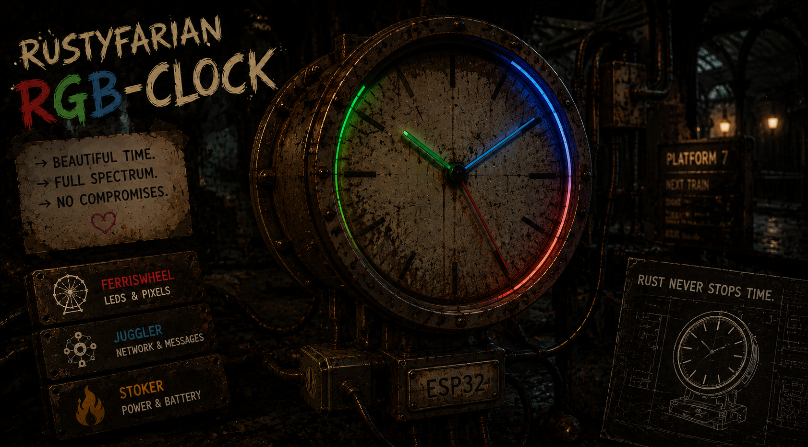

# ESP32 C6 RGB Clock

<p>
  
</p>

[](https://github.com/datenkollektiv/rustyfarian-rgb-clock/actions/workflows/rust.yml)
[](LICENSE)
[](https://github.com/esp-rs/rust)
[](https://github.com/datenkollektiv/rustyfarian-rgb-clock/actions/workflows/fmt.yml)
[](https://github.com/datenkollektiv/rustyfarian-rgb-clock/actions/workflows/audit.yml)

An ESP32-C6 RGB LED clock that displays time using 12 WS2812 NeoPixel LEDs arranged in a clock face. Time is received via MQTT from an external source.

> Note: Parts of this library were developed with the assistance of AI tools.
> All generated code has been reviewed and curated by the maintainer.

## Vision

> Validate a replicable three-tier embedded testing pyramid (host tests, Wokwi simulation, hardware-in-the-loop) using a working RGB clock as the test fixture.
> That lets future rustyfarian projects adopt the approach with confidence.

**We are building this for:** ourselves — learning and preparation for future embedded Rust projects and for future rustyfarian projects that will inherit this testing approach.

**Long-term goals:**
- All three testing tiers running green in CI
- Documentation is good enough to replicate the testing pyramid in new projects
- Mature the shared rustyfarian crates through real usage and test coverage

**Out of scope:** new clock features (those belong in other projects), hardware compatibility beyond ESP32-C6, and building a general-purpose testing framework.

*Full vision, success signals, and open questions: [VISION.md](./VISION.md)*

## Hardware

| Signal                   | ESP32-C6 pin | ESP32-C3 pin |
|:-------------------------|:-------------|:-------------|
| WS2812 clock ring (DIN)  | **GPIO 18**  | **GPIO 4**   |
| Onboard RGB LED          | GPIO 8       | GPIO 8       |

The ring uses the rustyfarian standard WS2812 data pin per chip, the same wiring as the `rustyfarian-ws2812` examples.
Pin assignments live in `src/main.rs`.

## Quick Start

Build for ESP32-C6 (default)

```sh
just build
```

Build for ESP32-C3

```sh
just build idf_c3_rgb_clock
```

Flash and open monitor (ESP32-C6 default)

```sh
just run
just monitor
```

Flash or run for ESP32-C3

```sh
just flash idf_c3_rgb_clock
just run idf_c3_rgb_clock
```

Port auto-detection in `scripts/detect-port.sh` works on macOS and Linux.
On Windows, set `ESPFLASH_PORT` before flashing:

```sh
ESPFLASH_PORT=COM3 just flash
```

Run all pre-commit checks (partition table, format, check, clippy, test)

```sh
just verify
```

The partition checks run first because they are the cheapest and guard the most expensive mistake.
`just partition-check` validates `partitions.csv` against the rules ESP-IDF enforces only at flash time:

- 64 KiB alignment for app partitions
- exact `type/subtype` pairs
- `otadata` sized to two sectors
- no overlaps
- slots large enough for the image
- `nvs` still at its original offset so provisioned credentials survive

`just partition-check-tests` runs a 12-case regression suite over the fixtures in `scripts/partition-fixtures/`.
It asserts that each way a table can be wrong is still rejected with the right diagnostic.
`just partition-check` and `just partition-check-tests` both run in CI.

Wi-Fi and MQTT credentials are provisioned at runtime via a SoftAP captive portal — no credentials live in the firmware image.
A `.env` is optional: it only supplies **non-secret** defaults that pre-fill the portal form (see `.env.example`); passwords are never set there.
On first boot (or after `just erase-flash`) the clock ring pulses amber and the device hosts an open `Rustyfarian-XXXX` access point.
Connect to it, open the captive portal, and submit your Wi-Fi + MQTT details.
See [docs/features/archive/wifi-softap-provisioning-v1.md](docs/features/archive/wifi-softap-provisioning-v1.md) for details.
Run `just setup-cargo-config` to create `.cargo/config.toml` from the template.

### Reprovisioning & recovery

To change credentials — or recover from a mistyped password, a broker change, or a renamed/vanished
Wi-Fi network — clear the stored config and reboot back into the portal:

```sh
just erase-flash
```

Then power-cycle the device, join the open `Rustyfarian-XXXX` access point, open the captive portal, and
submit the new Wi-Fi + MQTT details.
This requires host tooling and a cable today; a cable-free BOOT-button trigger is a planned follow-up.

The provisioning AP is **open (no password)** by default — a conscious tradeoff for local, physical,
first-boot setup, not a convenience default.
It is reachable only while the device is unprovisioned and is never exposed over the joined network.
See the [threat model](docs/features/archive/wifi-softap-provisioning-v1.md#security-stance--threat-model) for the
accepted residual risk and the WPA2 hardening path.

## Bare-metal esp-hal clock (ESP32-C3)

The same clock also builds as a bare-metal `esp-hal` firmware for the ESP32-C3, next to the ESP-IDF firmware, which stays the default and the only build with OTA.
It needs the `esp` toolchain from `espup`, and the recipes take the chip as an argument (`c3` is the only one for now).

```sh
just flash-hal c3
```

The ring shows a rainbow at boot and, once connected, a static 12:34:56 (blue LED 11, green LED 5, red LED 10) — the hands do not move until MQTT time lands.
SoftAP provisioning, Wi-Fi station mode and BOOT-button portal re-entry are validated on the C3.
MQTT time and OTA are not in this tier yet.
The two tiers use different partition tables and provisioning stores, so moving a board between them needs a full `just flash` and re-provisioning.
Design and milestones: [docs/features/esp-hal-clock-v1.md](docs/features/esp-hal-clock-v1.md).

## MQTT Time Format

The clock subscribes to the `tick` topic and expects JSON messages:

```json
{"hour": 14, "minute": 23, "second": 45}
```

Example using mosquitto_pub:

```sh
mosquitto_pub -h <MQTT_HOST> -t tick -m '{"hour":14,"minute":23,"second":45}'
```

Fields:
- `hour`: 0-23 (24-hour format, mapped to 12 positions)
- `minute`: 0-59 (mapped to 12 positions)
- `second`: 0-59 (mapped to 12 positions)

Both firmwares reject a tick with a value out of range, a missing or extra key, or more than 64 bytes, and keep the current face.

## Flashing

The 4 MiB flash carries an A/B OTA layout: `ota_0` and `ota_1` at 1.75 MiB each, plus `otadata`, `nvs` and `phy_init`, as defined in `partitions.csv`.

```sh
just flash
just monitor
```

- `just flash` flashes the bootloader built from this project's `sdkconfig.defaults`, never espflash's bundled one, because only that one has OTA rollback enabled.
- Before flashing it validates the partition table and checks that the image fits both slots (`just image-check`).
- It refuses an attached chip that differs from the target, and needs exactly one serial port or an explicit `ESPFLASH_PORT`.
- `DRY_RUN=1 just flash` prints the device-touching commands without running them.
- A partition layout change needs a full erase with `just flash-baseline`, which also clears `nvs`, so the device must be re-provisioned afterwards.

Pass the target for the C3 (`just flash idf_c3_rgb_clock`).
The reasoning behind each safeguard is in the [OTA feature doc](docs/features/archive/ota-mvp-v1.md#decisions).

## OTA updates

The clock updates itself over the LAN: an MQTT command on `ota/command` points it at a manifest.
It downloads and verifies the image into the inactive slot, reboots into it, and marks it valid only after a health check.
An image that fails the check, or does not report the version its manifest promised, rolls back to the previous slot.
Progress and results are published on `ota/status`.

```sh
OTA_VERSION=0.3.7 just ota-artifact idf_c3_rgb_clock
just ota-serve
```

Then, from another shell, send the staged manifest and follow the result (broker from `.env`):

```sh
just ota-push idf_c3_rgb_clock
just ota-status
```

The offered version must be newer than the running one, and a version that was rolled back is refused until a different one is applied.
This is a LAN demo: images are served over plain HTTP and integrity rests on SHA-256 alone.

- Testing on hardware: [OTA hardware test runbook](docs/runbooks/ota-hardware-test.md)
- Design, wire contract and status codes: [OTA feature doc](docs/features/archive/ota-mvp-v1.md)

## Dependencies

This project uses external crates from companion repositories:

All of them are consumed from crates.io; this repository has no git dependencies.

| Crate                         | Version               | Repository                                                                   | Description                               |
|:------------------------------|:----------------------|:-----------------------------------------------------------------------------|:------------------------------------------|
| `ferriswheel`                 | 0.7.0                 | [rustyfarian-ws2812](https://github.com/datenkollektiv/rustyfarian-ws2812)   | RGB ring effects (rainbow animations)     |
| `rustyfarian-esp-idf-ws2812`  | 0.7.0                 | [rustyfarian-ws2812](https://github.com/datenkollektiv/rustyfarian-ws2812)   | ESP-IDF RMT driver for WS2812             |
| `rustyfarian-esp-idf-network` | 0.6.0                 | [rustyfarian-network](https://github.com/datenkollektiv/rustyfarian-network) | Wi-Fi, MQTT, SoftAP provisioning, and OTA |

The separate `rustyfarian-esp-idf-wifi` and `rustyfarian-esp-idf-mqtt` crates were consolidated upstream into `rustyfarian-esp-idf-network`.
This firmware enables its features explicitly (`wifi`, `mqtt`, `provisioning`, `ota`).

## Project Structure

```text
rustyfarian-rgb-clock/           # This repository
├── src/                         # Application code
│   ├── main.rs                  # Entry point, provisioning and Wi-Fi/MQTT setup
│   └── rgb_clock.rs             # Clock display logic
├── crates/
│   └── clock-pure/              # Pure Rust clock utilities (host-testable)
├── partitions.csv               # A/B OTA flash layout (validated by just partition-check)
├── sdkconfig.defaults           # ESP-IDF settings, incl. bootloader rollback
└── scripts/                     # just recipe implementations
    ├── preflight.sh             # Build and validate before any flash
    ├── flash.sh                 # Build, then flash via flash-image.sh
    ├── flash-image.sh           # Flash-only step (no build, no validation)
    ├── check-partitions.sh      # Partition table validator
    └── partition-fixtures/      # Fixtures for the validator's regression suite
```

### Local Development

For developing alongside the external crates, `.cargo/config.toml` can redirect them to sibling working trees.
Every dependency now resolves from crates.io, so the patches belong under the `crates-io` key:

```toml
[patch.crates-io]
bunting = { path = "../rustyfarian-ws2812/crates/bunting" }
pennant = { path = "../rustyfarian-ws2812/crates/pennant" }
ferriswheel = { path = "../rustyfarian-ws2812/crates/ferriswheel" }
rustyfarian-esp-idf-ws2812 = { path = "../rustyfarian-ws2812/crates/rustyfarian-esp-idf-ws2812" }
rustyfarian-esp-idf-network = { path = "../rustyfarian-network/crates/rustyfarian-esp-idf-network" }
```

Cargo keys `[patch]` sections by dependency source, so a leftover `[patch."https://github.com/..."]` section silently stops applying once a crate moves to crates.io.
Builds quietly use the published version, and only a "patch was not used in the crate graph" warning hints at it.
Leave the network entry out while verifying a release, or a local-only fix will mask a gap in the published crate.

Comment out the patches to build against the published GitHub repos.

## License

MIT
